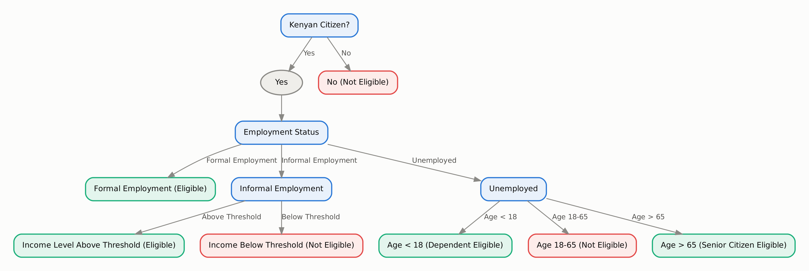
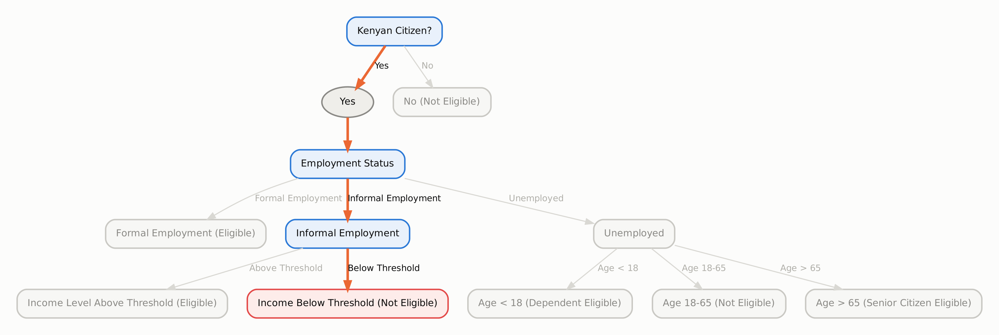
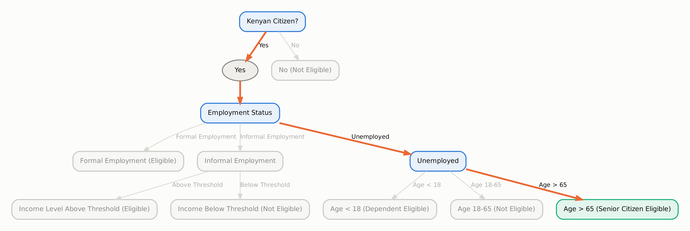
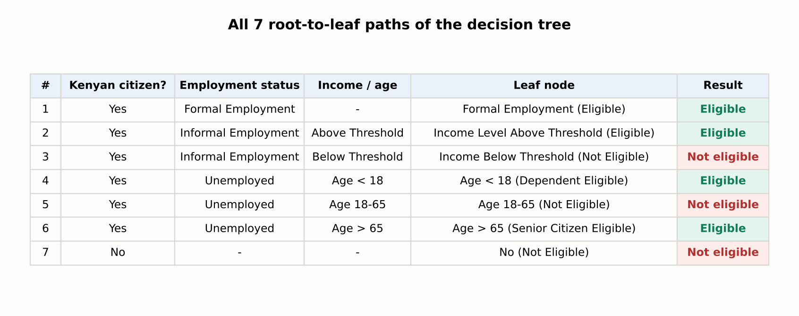
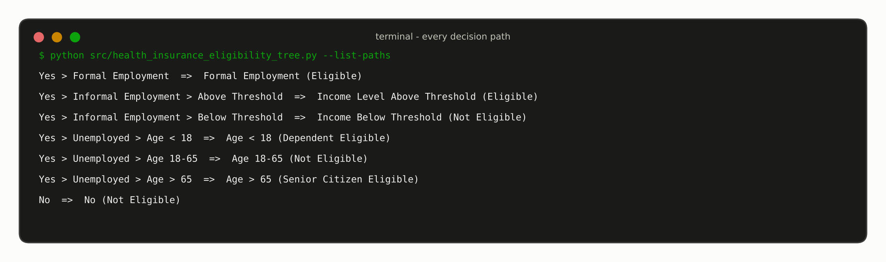

# Kenya SHA / SHIF Health Insurance Eligibility Decision Tree with Graphviz (Python)


A small Python tool that **draws a decision tree** for *"who is eligible for public health insurance?"* in the context of Kenya's **Social Health Authority (SHA)** and its **Social Health Insurance Fund (SHIF)**. The tree is defined once as plain data, rendered to PNG / SVG / PDF with **Graphviz**, and can also be listed as text - every root-to-leaf decision path with its outcome.



> ## ⚠️ Important - this is a simplified teaching model
> The tree is a **classroom-style simplification** used to practise decision-tree modelling and diagram generation. It is **not** the official SHA/SHIF eligibility or contribution rules, it is not legal or financial advice, and it must **not** be used to decide whether a real person is covered. For real rules, registration and contribution information, use the official SHA channels (the SHA website, `sha.go.ke`, and its offices).
> Modelling choices such as "unemployed adults aged 18-65 are not eligible" or the unspecified income "threshold" are **assumptions of the exercise**.

---

## Table of contents

1. [Background](#1-background)
2. [What the project does](#2-what-the-project-does)
3. [The decision logic](#3-the-decision-logic)
4. [Reading the diagram](#4-reading-the-diagram)
5. [Worked examples](#5-worked-examples)
6. [All seven outcomes](#6-all-seven-outcomes)
7. [Project structure](#7-project-structure)
8. [Getting started](#8-getting-started)
9. [How the code works](#9-how-the-code-works)
10. [Customizing the tree](#10-customizing-the-tree)
11. [Troubleshooting](#11-troubleshooting)
12. [What changed compared with the original script](#12-what-changed-compared-with-the-original-script)
13. [Design notes and limitations](#13-design-notes-and-limitations)
14. [Ideas for extending the project](#14-ideas-for-extending-the-project)
15. [Glossary](#15-glossary)
16. [FAQ](#16-faq)

---

## 1. Background

Kenya's **Social Health Authority (SHA)** is a state corporation, created under the **Social Health Insurance Act of 2023**, that manages public health insurance. It began operating on **1 October 2024**, replacing the **National Health Insurance Fund (NHIF)**. The **Social Health Insurance Fund (SHIF)** is one of the funds SHA administers.

Eligibility questions are a natural fit for a **decision tree**: a sequence of yes/no (or multi-way) questions, each narrowing the situation until an outcome is reached. This project models one such tree and turns it into a picture.

## 2. What the project does

| Capability | How |
|---|---|
| Define the tree as **data** | two tables in `src/health_insurance_eligibility_tree.py`: `NODES` (12 nodes) and `EDGES` (11 edges) |
| **Render** it with Graphviz | `python src/health_insurance_eligibility_tree.py` → `output/insurance_tree.png` (also `--format svg` / `pdf`) |
| **Color-code** the outcome | blue = question, green = eligible, red = not eligible, grey = pass-through answer |
| **Highlight** one path | `create_insurance_tree(highlight_leaf="I")` draws a single decision path in bold orange |
| **List** every decision path as text | `--list-paths` |
| **Test** that the tree is well-formed | 7 unit tests: a proper tree, 7 leaves, one path per leaf, exhaustive age branches… |

## 3. The decision logic

The tree asks at most **three questions**:

1. **Is the person a Kenyan citizen?** - if not, the outcome is *Not eligible*.
2. **What is the employment status?** - formal, informal or unemployed.
3. **A follow-up that depends on the status:**
   * *Formal employment* → outcome *Eligible* (no further question).
   * *Informal employment* → is income **above or below the threshold**?
   * *Unemployed* → what is the **age** - under 18, 18-65, or over 65?

### Outcomes

| Branch | Outcome in this model |
|---|---|
| Not a Kenyan citizen | Not eligible |
| Citizen, formal employment | **Eligible** |
| Citizen, informal employment, income above threshold | **Eligible** |
| Citizen, informal employment, income below threshold | Not eligible |
| Citizen, unemployed, age < 18 | **Eligible** (as a dependent) |
| Citizen, unemployed, age 18-65 | Not eligible |
| Citizen, unemployed, age > 65 | **Eligible** (senior citizen) |

### Shape of the tree

| Property | Value |
|---|---|
| Nodes | 12 (`A`-`L`) |
| Edges | 11 (a tree with *n* nodes always has *n* − 1 edges) |
| Decision (internal) nodes | 5: `A`, `B`, `D`, `F`, `G` |
| Leaf (outcome) nodes | 7: `C`, `E`, `H`, `I`, `J`, `K`, `L` |
| Eligible / not-eligible leaves | 4 / 3 |
| Depth (longest root-to-leaf path) | 4 edges |

## 4. Reading the diagram

| Colour / shape | Meaning |
|---|---|
| 🟦 **blue rounded box** | a *question* or branching point (`Kenyan Citizen?`, `Employment Status`, `Informal Employment`, `Unemployed`) |
| ⚪ **grey ellipse** | the *"Yes"* answer node that connects the citizenship question to the employment question |
| 🟩 **green rounded box** | leaf: **Eligible** |
| 🟥 **red rounded box** | leaf: **Not eligible** |
| text on an arrow | the answer that leads along that branch |

Each outcome is written in words as well as colour (`(Eligible)` / `(Not Eligible)` in the label), so the diagram stays readable in greyscale and for colour-blind readers.

## 5. Worked examples

### Example 1 - an informal worker below the income threshold

> A Kenyan citizen works informally and earns below the threshold.

`Kenyan Citizen? → Yes → Employment Status → Informal Employment → Below Threshold → Income Below Threshold (Not Eligible)`



### Example 2 - an unemployed senior citizen

> A Kenyan citizen is unemployed and over 65.

`Kenyan Citizen? → Yes → Employment Status → Unemployed → Age > 65 → Age > 65 (Senior Citizen Eligible)`



Both images are produced by the same function with a different `highlight_leaf`:

```python
from health_insurance_eligibility_tree import create_insurance_tree

create_insurance_tree(highlight_leaf="I")   # example 1
create_insurance_tree(highlight_leaf="L")   # example 2
```

## 6. All seven outcomes



The same information as text, straight from the command line:



```text
$ python src/health_insurance_eligibility_tree.py --list-paths
Yes > Formal Employment  =>  Formal Employment (Eligible)
Yes > Informal Employment > Above Threshold  =>  Income Level Above Threshold (Eligible)
Yes > Informal Employment > Below Threshold  =>  Income Below Threshold (Not Eligible)
Yes > Unemployed > Age < 18  =>  Age < 18 (Dependent Eligible)
Yes > Unemployed > Age 18-65  =>  Age 18-65 (Not Eligible)
Yes > Unemployed > Age > 65  =>  Age > 65 (Senior Citizen Eligible)
No  =>  No (Not Eligible)
```

## 7. Project structure

```text
kenya-sha-shif-health-insurance-eligibility-decision-tree-graphviz-python/
├── README.md
├── requirements.txt
├── .gitignore
├── src/
│   └── health_insurance_eligibility_tree.py   # NODES / EDGES data, rendering, CLI
├── tests/
│   └── test_eligibility_tree.py               # 7 unit tests
├── scripts/
│   └── generate_readme_images.py              # re-creates every image in docs/images
└── docs/
    └── images/                                # diagrams used in this README
```

## 8. Getting started

### Requirements

You need **two** things - the Python wrapper and the Graphviz program it calls:

| Requirement | Install |
|---|---|
| Python 3.8+ | <https://www.python.org/downloads/> |
| `graphviz` Python package | `pip install graphviz` (or `pip install -r requirements.txt`) |
| **Graphviz system package** (provides the `dot` command) | macOS: `brew install graphviz` · Ubuntu/Debian: `sudo apt install graphviz` · Windows: `winget install Graphviz.Graphviz` or the installer from <https://graphviz.org/download/> |

> `pip install graphviz` alone is **not** enough - it only writes the instructions; the separate Graphviz program draws the picture.

### Run it

```bash
git clone https://github.com/<your-username>/kenya-sha-shif-health-insurance-eligibility-decision-tree-graphviz-python.git
cd kenya-sha-shif-health-insurance-eligibility-decision-tree-graphviz-python

pip install -r requirements.txt

python src/health_insurance_eligibility_tree.py                  # writes output/insurance_tree.png
python src/health_insurance_eligibility_tree.py --format svg     # vector image
python src/health_insurance_eligibility_tree.py --list-paths     # text, no Graphviz needed
python src/health_insurance_eligibility_tree.py --view           # also open the image
```

| Option | Meaning | Default |
|---|---|---|
| `--output-dir DIR` | folder for the output files | `output/` |
| `--format {png,svg,pdf}` | image format | `png` |
| `--view` | open the result in the default viewer afterwards | off |
| `--list-paths` | print every decision path and exit (does not need the `dot` program) | off |

Next to the image the tool keeps `insurance_tree.gv`, the Graphviz source in the DOT language - you can open it in any Graphviz viewer or edit it by hand:

```dot
// SHA/SHIF Eligibility Tree
digraph {
	bgcolor="#fcfcfb" nodesep=0.35 pad=0.3 ranksep=0.55
	node [fontcolor="#0b0b0b" fontname=Helvetica fontsize=12 margin="0.18,0.1" penwidth=1.8]
	edge [color="#8a8985" fontcolor="#52514e" fontname=Helvetica fontsize=11 penwidth=1.3]
	A [label="Kenyan Citizen?" color="#2a78d6" fillcolor="#e9f1fb" shape=box style="rounded,filled"]
	B [label=Yes color="#8a8985" fillcolor="#efeeea" shape=ellipse style=filled]
	...
}
```

### Use it as a library

```python
import sys
sys.path.insert(0, "src")
import health_insurance_eligibility_tree as t

t.render_tree(output_dir="docs", fmt="svg")           # write docs/insurance_tree.svg
tree = t.create_insurance_tree(highlight_leaf="L")    # a graphviz.Digraph you can customise further
print(tree.source)                                    # the DOT text

for path in t.format_paths():                         # one line per decision path
    print(path)

t.leaves()                                            # ['C', 'E', 'H', 'I', 'J', 'K', 'L']
t.is_eligible("H")                                    # True
```

### Run the tests

```bash
python -m unittest discover -s tests -v
```

(The two tests that inspect the generated Graphviz source are skipped automatically if the `graphviz` Python package is not installed.)

### Regenerate the README images

```bash
python scripts/generate_readme_images.py        # needs matplotlib, graphviz and the `dot` program
```

## 9. How the code works

### The tree is data

```python
NODES = {                                   # id -> (label, kind)
    "A": ("Kenyan Citizen?", "question"),
    "E": ("Formal Employment (Eligible)", "eligible"),
    ...
}
EDGES = [                                   # (from, to, edge label)
    ("A", "B", "Yes"),
    ("A", "C", "No"),
    ("D", "E", "Formal Employment"),
    ...
]
```

The `kind` of a node (`question`, `answer`, `eligible`, `not_eligible`) selects its colours and shape from the `STYLES` table. Because the picture, the text listing and the tests are all produced from these two tables, they can never disagree with each other.

### Functions

| Function | Returns / does |
|---|---|
| `create_insurance_tree(highlight_leaf=None, fontname="Helvetica")` | builds and returns the `graphviz.Digraph` (writes nothing) |
| `render_tree(output_dir, fmt, view, **kwargs)` | renders to `<output_dir>/insurance_tree.<fmt>` and returns the file path |
| `root_to_leaf_paths()` | every path as a list of `(node_id, edge_label_taken)` pairs, found by walking `EDGES` from the root |
| `leaves()` | ids of nodes with no outgoing edge |
| `is_eligible(leaf_id)` | `True` for green leaves |
| `format_paths()` | the lines printed by `--list-paths` |
| `main(argv)` | the command-line interface, with a friendly message when `dot` is not installed |

### How highlighting works

`create_insurance_tree(highlight_leaf="I")` finds the root-to-leaf path that ends at `I`, draws its edges in bold orange and fades every node and edge that is not on it.

## 10. Customizing the tree

**Rename or reword a node** - edit its label in `NODES`; nothing else changes.

**Add a branch** - add a node and an edge. For example, to split *formal employment* by employer type:

```python
NODES["M"] = ("Public Sector (Eligible)", "eligible")
NODES["N"] = ("Private Sector (Eligible)", "eligible")
# and replace the ("D", "E", "Formal Employment") edge with:
EDGES += [("E", "M", "Public"), ("E", "N", "Private")]
```

(Make `E` a `"question"` node if it should no longer be a leaf. The tests pin the *original* tree - 12 nodes, 7 leaves and so on - so update their expected values when you change the structure; the "it is a proper tree" checks (one parent per node, everything reachable from the root) remain a useful guard.)

**Change colours or shapes** - edit the `STYLES` dictionary; keep a text cue such as `(Eligible)` in the label so the meaning does not depend on colour.

**Different layout direction** - after `create_insurance_tree()`, call `tree.attr(rankdir="LR")` to draw left-to-right.

**Different font** - `create_insurance_tree(fontname="Arial")`.

## 11. Troubleshooting

| Symptom | Cause | Fix |
|---|---|---|
| `The Graphviz program 'dot' was not found…` | the Graphviz *system* package is missing or not on `PATH` | install it (see [§8](#8-getting-started)) and open a new terminal |
| `The 'graphviz' Python package is missing` | wrapper not installed | `pip install graphviz` |
| `--view` does nothing on a server | no desktop / default viewer | omit `--view` and open the file yourself |
| Letters or labels look different from the images in this README | the README images use the DejaVu Sans font; the default is Helvetica | pass `fontname="DejaVu Sans"` (or any font installed on your system) |
| Edge labels overlap on a long label | Graphviz auto-layout | increase spacing: `tree.attr(ranksep="0.9", nodesep="0.5")` |
| `--list-paths` works but rendering fails | `dot` missing | `--list-paths` needs no Graphviz program; install it to render |

## 12. What changed compared with the original script

The original was a single function with 12 `tree.node(...)` and 11 `tree.edge(...)` calls and `tree.render('insurance_tree', view=True)`. **All 12 node ids, labels and 11 edges are unchanged.**

| Area | Original | Now |
|---|---|---|
| Structure | imperative calls inside one function | `NODES` and `EDGES` tables - one source of truth |
| Rendering | always `view=True` (tries to open a viewer, fails on servers) and wrote to the current folder | `view` is opt-in; output goes to `--output-dir` (default `output/`) |
| Import side effect | called `create_insurance_tree()` at import time | only runs from the command line (`if __name__ == "__main__"`) |
| Look | default Graphviz ellipses, all the same colour | colour-coded outcomes and question nodes |
| Output formats | PNG only | PNG, SVG or PDF |
| Text output | none | `--list-paths` |
| Highlighting | none | `highlight_leaf` |
| Errors | raw traceback if `dot` is missing | friendly install instructions |
| Tests, docs, images | none | 7 unit tests, this README, reproducible diagrams |

## 13. Design notes and limitations

* **A hand-built rule tree, not machine learning.** Nothing is trained from data. (A *learned* decision tree, e.g. scikit-learn's `DecisionTreeClassifier`, is built by an algorithm from labelled examples; this one is written down by a person.)
* **The pass-through node.** Node `B` ("Yes") only forwards to `Employment Status`, so the word *Yes* appears twice in a row (on the arrow and in the node). It is kept because it was in the original diagram; removing `B` and drawing `A → D` labelled *Yes* would make the tree one node smaller.
* **"Threshold" is undefined.** The income threshold is a label, not a number - the model cannot evaluate a real income.
* **Age ranges are written in labels**, not enforced by code; the tests only check that the three age branches are present.
* **It is a diagram generator, not an eligibility calculator.** There is no function that takes a person's details and returns a verdict.
* **Simplified policy.** As stated at the top, the branches are assumptions for the exercise, not official rules.

## 14. Ideas for extending the project

* Add `check_eligibility(citizen, employment, income_above_threshold=None, age=None)` that walks `EDGES` and returns the outcome (and the path taken).
* An **interactive question-and-answer** command-line mode that asks the questions from the tree.
* Load the tree from a **JSON/YAML** file so non-programmers can edit it.
* Add the **contribution** side (what a member pays) as a second tree.
* Generate the same tree with **scikit-learn** from example data and compare it with the hand-built one.
* Export an interactive **HTML/SVG** version with tooltips, or a **Mermaid** version for Markdown pages.

## 15. Glossary

| Term | Meaning |
|---|---|
| **SHA** | Social Health Authority - the Kenyan state corporation that manages public health insurance |
| **SHIF** | Social Health Insurance Fund - a fund administered by SHA |
| **NHIF** | National Health Insurance Fund - the scheme SHA replaced in October 2024 |
| **Decision tree** | a branching diagram of questions that ends in outcomes |
| **Root / internal / leaf node** | the first question / any later question / a final outcome |
| **Branch (edge)** | the connection labelled with an answer |
| **Graphviz** | open-source graph-drawing software |
| **DOT** | Graphviz's text language for describing graphs (`.gv` files) |
| **Digraph** | a *directed* graph - edges have a direction (here, from question to answer) |

## 16. FAQ

**Is this the real SHA eligibility process?**
No. It is a simplified model for learning. Use official SHA sources for real decisions.

**Why does the tree have a node that just says "Yes"?**
It is part of the original diagram. See [§13](#13-design-notes-and-limitations).

**Do I need Graphviz installed to run the tests?**
No - the tree-structure tests do not need it, and the two tests that read the Graphviz source skip themselves if only the Python package is missing.

**Can I get the diagram as a vector image for a report or slide?**
Yes: `--format svg` or `--format pdf`.

**Can I put the tree in a README without an image file?**
Yes - GitHub renders Mermaid. Converting `NODES` and `EDGES` into a Mermaid `flowchart TD` block is a small extension (see the ideas above).
